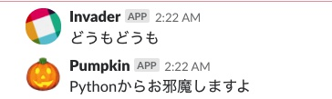

SlackPostman
===

Slack に投稿します



## Webhook URL

ここから登録。

[https://slack.com/apps/A0F7XDUAZ--web-](https://slack.com/apps/A0F7XDUAZ--web-)

## Usage

Python のほう。

```python
postman = SlackPostman(
    webhook_url,
    sender = 'Invader',
    sender_emoji = ':trollface:'
)
postman.post('どうもどうも')
```

`post()` は JSON 形式で送信し、`requests.Response` をそのまま返します。10 秒でタイムアウトします。

コマンドからも送信できます。Webhook URL はコードに書かず、環境変数で渡します。

```bash
export SLACK_WEBHOOK_URL='https://hooks.slack.com/services/...'
python SlackPostman.py 'どうもどうも'
```

送信に失敗した場合は終了コード 1、引数や環境変数が足りない場合は 2 で終了します。エラーには Webhook URL を表示しません。

PHP のほう。

```php
$postlady = new SlackPostlady(
    $webhookUrl,
    'Invader',
    ':trollface:'
);
print($postlady->post('test'));
```

## テスト

Python 版は Slack に送信せず、モックで確認します。

```bash
pip install -r requirements.txt
python -m unittest -v
```

GitHub Actions でも master への push と PR のたびに実行します。
